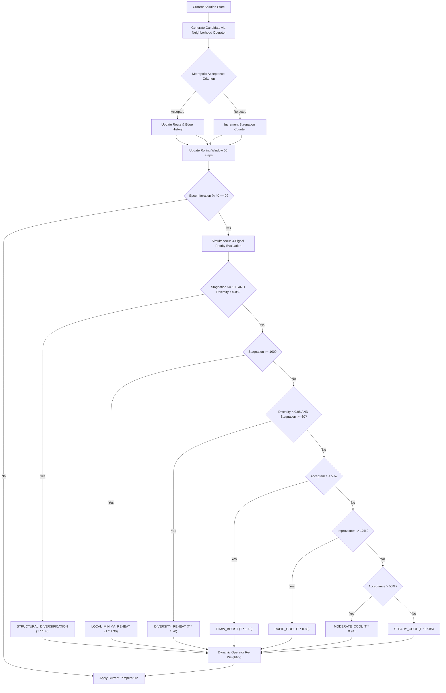

# ⚡ Adaptive Simulated Annealing (ASA) Platform

<div align="center">


**A Real-Time Interactive Optimization Laboratory and Visual Analytics Engine for Traveling Salesperson Problem (TSP) with Online Feedback Temperature Control.**

[Overview](#-overview--core-concept) •
[Why Adaptive SA?](#-the-problem-with-conventional-sa) •
[Control Architecture](#-adaptive-feedback-control-architecture) •
[Interactive Features](#-interactive-features--dashboard) •
[Quick Start](#-quick-start) •
[Architecture](#-system-architecture) •
[API & Protocols](#-websocket--rest-api-reference) •
[Mathematical Foundations](#-mathematical-foundations)

</div>

---

## 📖 Overview & Core Concept

The **Traveling Salesperson Problem (TSP)** is one of the foundational NP-hard problems in theoretical computer science and combinatorial optimization. Given a set of $N$ cities, the objective is to determine the closed-loop tour that visits every city exactly once and returns to the origin city with the minimum possible total Euclidean distance.

As $N$ scales, the search space grows factorially as $\frac{(N-1)!}{2}$:
- For $N = 10$ cities: **181,440** possible routes
- For $N = 25$ cities: **$3.1 \times 10^{23}$** possible routes
- For $N = 50$ cities: **$3.04 \times 10^{62}$** possible routes (exceeding the estimated number of atoms in the Milky Way)

Exact solvers (such as Branch & Bound or Concorde) become computationally prohibitive for large-scale or real-time distributed routing. Meta-heuristics like **Simulated Annealing (SA)** sample this immense landscape probabilistically to find near-optimal tours within seconds.

The **Adaptive Simulated Annealing (ASA) Platform** delivers a full-stack, real-time, explainable optimization system that demonstrates how online feedback loops dramatically outperform conventional static cooling schedules.

---

## 🔍 The Problem with Conventional SA

### The Metallurgical Analogy
In physical metallurgy, heating metal past its recrystallization temperature gives atoms sufficient kinetic energy to wander freely and escape disordered arrangements. Slowly reducing the temperature allows them to crystallize into a defect-free, minimum-energy lattice. If cooled too abruptly (quenched), the material develops brittle imperfections and fractures.

In optimization:
- **High Temperature ($T$)**: The algorithm explores broad regions of the solution space, readily accepting worse solutions ($\Delta E > 0$) to cross high-energy barriers.
- **Low Temperature ($T$)**: The algorithm exploits local neighborhoods, settling into the nearest valley of the objective function.

### The Fatal Flaw: Blind Geometric Cooling
Conventional Simulated Annealing (CSA) relies on a static, open-loop cooling function:

$$T_{k+1} = \alpha \cdot T_k \quad (\text{where } \alpha \approx 0.995)$$

This static schedule suffers from two critical failure modes:
1. **Premature Freezing (Quenching)**: If temperature decreases too quickly before finding promising basins of attraction, the acceptance probability collapses to near-zero. The algorithm freezes prematurely in a sub-optimal basin.
2. **Local Minima Trapping**: Once the system cools, kinetic energy is permanently dissipated. If the tour is stuck in a knotted local minimum (where any single 2-opt or swap move increases total cost), **it can never escape**. It is trapped indefinitely, wasting remaining compute budget.

```
Conventional SA (Open-Loop):
  Start [T_0] ──> [Fixed Decay α] ──> [Temperature Drops] ──> [Trapped in Local Minimum] ──> [Frozen Forever]

Adaptive SA (Closed-Loop Feedback):
  Start [T_0] ──> [Search State Sensors] ──> [Dynamic Feedback Controller]
                         ▲                                │
                         │── [Reheat / Thaw / Cool Rate] ─┘
```

---

## 🧠 Adaptive Feedback Control Architecture

The ASA engine replaces open-loop cooling with an **Online Feedback Controller** (`AdaptiveTemperatureController` in [`backend/main.py`](file:///Users/likhithmedarametla/Documents/AI/adaptive-sa/backend/main.py)). Every 40 iterations (epoch window), the controller analyzes search telemetry from a rolling 50-step window and dynamically selects one of six operational modes:



### 1. Multi-Signal Priority Engine (Fixing Priority Inversion)

Previously, checking deep stagnation before diversity collapse caused priority shadowing where diversity-specific remedies were skipped. The upgraded controller resolves all 4 signals simultaneously via an explicit priority policy:

| Priority | Search Dynamics Signature | Controller Decision | Action & Multiplier | Search Mode | Strategic Purpose |
| :--- | :--- | :--- | :--- | :--- | :--- |
| **P1 (Highest)** | $S \ge 100$ **AND** $D < 0.08$ | `STRUCTURAL_DIVERSIFICATION` | $T \times 1.45$ + 30% Or-Opt & 20% Insert | **Exploration** | Catastrophic entrapment: breaks cyclic sub-tour traps by shifting operator weights away from 2-opt. |
| **P2** | $S \ge 100$ ($D \ge 0.08$) | `LOCAL_MINIMA_REHEAT` | $T \times 1.30$ | **Exploration** | Deep stagnation in local valley while maintaining healthy topological variance. |
| **P3** | $D < 0.08$ ($S \ge 50$) | `DIVERSITY_REHEAT` | $T \times 1.20$ | **Exploration** | Tour oscillating between identical topological edges; warms system to sample new configurations. |
| **P4** | $W_{acc} < 0.05$ ($T < 0.7 T_{\max}$) | `THAW_BOOST` | $T \times 1.15$ | **Exploration** | Premature freeze; unfreezes the search to restore exploratory mobility. |
| **P5** | $W_{imp} > 0.12$ | `RAPID_COOL` | $T \times 0.88$ + 80% 2-Opt | **Exploitation** | Fertile downhill gradient: accelerates cooling to converge onto the local basin minimum. |
| **P6** | $W_{acc} > 0.55$ | `MODERATE_COOL` | $T \times 0.94$ | **Exploitation** | Overly loose search: quenches excess thermal energy to reduce random walk. |
| **P7 (Nominal)**| Metrics inside envelope | `STEADY_COOL` | $T \times 0.985$ | **Balanced** | Smooth geometric cooling preserving search balance. |

### 2. Native Ablation Study Suite

To scientifically demonstrate which signals provide measurable benefits, the platform supports 7 execution modes:
- **`full`**: Full multi-signal adaptive controller ($W_{acc}, W_{imp}, S, D$).
- **`acceptance_only`**: Classic adaptive SA baseline adjusting temperature purely based on acceptance rate (Kirkpatrick / Aarts-Laarhoven).
- **`standard_sa`**: Fixed open-loop geometric cooling schedule ($\alpha = 0.995$) with zero online feedback.
- **`no_diversity`**: Ablation variant disabling edge diversity feedback ($D$ clamped to nominal $0.50$).
- **`no_stagnation`**: Ablation variant disabling stagnation reheats ($S$ clamped to 0).
- **`no_acceptance`**: Ablation variant disabling acceptance rate boosts and loose search cooling.
- **`no_improvement`**: Ablation variant disabling fertile valley rapid cooling bursts.

### 3. Dynamic Operator Weight Scheduling & Yield Tracking

The neighborhood generator combines four stochastic moves with weights that adjust dynamically:
1. **2-Opt Inversion (65% nominal, 80% in exploitation)**: Inverts the sequence between two cut points. Directly untangles crossing edges without disrupting the rest of the tour.
2. **Or-Opt Block Shift (15% nominal, 30% in structural diversification)**: Relocates a connected chain of 2 or 3 consecutive cities to another position in the tour. Preserves high-quality local subpaths while repairing global sequence.
3. **Insertion / Relocation (12% nominal, 20% in structural diversification)**: Extracts a single city and relocates it into another position.
4. **Random Swap (8% nominal, 15% in structural diversification)**: Swaps the indices of two distinct cities to break long-range linkages.

Every proposal tracks **acceptance yield** and **global improvement yield** in real time.

---

## 🎮 Interactive Features & Dashboard

The frontend ([`frontend/index.html`](file:///Users/likhithmedarametla/Documents/AI/adaptive-sa/frontend/index.html)) provides a glassmorphic dashboard built with vanilla CSS, modern typography (`Outfit` and `JetBrains Mono`), HTML5 Canvas, and Chart.js.

### Core Capabilities
- **Algorithm Comparison Modes**:
  - `Adaptive Simulated Annealing`: Full online feedback control, dynamic operator weighting, and automated reheating.
  - `Conventional Simulated Annealing`: Fixed geometric schedule ($\alpha = 0.995$).
  - `Side-by-Side Benchmark`: Runs Conventional SA first, followed by Adaptive SA on the **exact same city topology and starting route**, displaying a final comparative scoreboard.
- **Synthetic City Topology Generators**:
  - `Random Scatter`: Uniformly distributed 2D coordinates across the $800 \times 500$ canvas.
  - `Clustered Logistics Hubs`: Multi-center Gaussian clusters representing realistic freight distribution depots.
  - `Circular Ring Topology`: Noisy circular layout ideal for visually testing edge crossing elimination.
  - `Manhattan Grid Lattice`: Orthogonal coordinate grid testing snake/Hamiltonian paths.
  - `Archimedean Spiral`: Continuous radial curve challenging local heuristics.
  - `Berlin52 (TSPLIB)`: The canonical 52-location TSPLIB benchmark instance with known global optimum.
- **Interactive City Designer**:
  - Click directly on the route canvas prior to starting a run to add custom waypoint locations.
- **Data Export & Telemetry**:
  - **📥 Export JSON**: Downloads optimal tour coordinates, traversal indices, and final cost as standard JSON.
  - **📊 Export CSV**: Exports complete iteration-by-iteration telemetry (cost, temperature, acceptance rate, stagnation, diversity).
  - **🔊 Web Audio Synthesizer**: Interactive sound feedback synthesizing distinct tones for Reheat escapes and completion arpeggios.
- **Full Execution Telemetry**:
  - **KPI Cards**: Live progress, Best tour length, % improvement, Temperature, Search mode badge, Acceptance rate, Stagnation counter, Total reheat events, Edge diversity score, and Last executed operator.
  - **Interactive Route Canvas**: Glow effects, animated node markers, directional tour vectors, and canvas coordinate auto-scaling.
  - **Real-Time Convergence Chart**: Tracks cost vs. iteration, overlaying both algorithms during benchmarks.
  - **Live AI Decision Stream**: Transparent log detailing the exact rationale behind every cooling or reheating event.
- **Session Controls**:
  - Start, Pause, Single-Step frame advance, Stop, and dynamic Speed Slider (0 ms to 30 ms delay per frame).

---

## 🚀 Quick Start

### Prerequisites
- **Python 3.9+** (tested on Python 3.9, 3.10, 3.11, 3.12)
- Modern web browser (Chrome, Safari, Firefox, Edge)

### One-Click Launch (Recommended)

Run the included launch script:
```bash
./run.sh
```

The script automatically verifies dependencies, starts the FastAPI server on port `8008`, and opens the console URL.

### Manual Setup

1. **Clone the repository**:
   ```bash
   git clone https://github.com/likhithm123/adaptive-sa.git
   cd adaptive-sa
   ```

2. **Create and activate a virtual environment**:
   ```bash
   python3 -m venv backend/venv
   source backend/venv/bin/activate
   ```
   *(On Windows: `backend\venv\Scripts\activate`)*

3. **Install dependencies**:
   ```bash
   pip install -r backend/requirements.txt
   ```

4. **Start the ASGI server**:
   ```bash
   cd backend
   python -m uvicorn main:app --host 0.0.0.0 --port 8008 --reload
   ```

5. **Access the application**:
   Navigate to **[http://127.0.0.1:8008](http://127.0.0.1:8008)** in your web browser.

---

## 📂 System Architecture

```
adaptive-sa/
├── backend/
│   ├── main.py                  # FastAPI app, WebSocket handlers, ASA controller & TSP solver
│   ├── requirements.txt         # Backend Python dependencies (fastapi, uvicorn, numpy, pytest, httpx)
│   └── venv/                    # Local Python virtual environment
├── frontend/
│   └── index.html               # Responsive single-page application (Canvas + Chart.js + UI + Audio)
├── tests/
│   └── test_sa.py               # 18 automated unit and integration tests (Pytest)
├── .github/
│   └── workflows/
│       └── ci.yml               # Multi-version Python CI/CD pipeline
├── Dockerfile                   # Production container definition
├── docker-compose.yml           # Container orchestration
├── run.sh                       # Automated startup script
├── .gitignore                   # Version control exclusion rules
└── README.md                    # Project documentation
```

### Module Breakdown

- **[`backend/main.py`](file:///Users/likhithmedarametla/Documents/AI/adaptive-sa/backend/main.py)**:
  - `generate_cities()`: Generates 2D city topologies (`random`, `clustered`, `circular`).
  - `route_cost()`: Computes total closed-loop Euclidean tour perimeter.
  - `two_opt_move()`, `insert_move()`, `swap_move()`: Neighborhood perturbation operators.
  - `get_tour_edges()` & `route_edge_difference()`: Jaccard-like topological edge diversity analyzer.
  - `AdaptiveTemperatureController`: Feedback engine with dynamic multipliers and threshold triggers.
  - `run_conventional_sa()` & `run_adaptive_sa()`: Asynchronous execution loops streaming WebSocket events.
  - `run_benchmark_comparison()`: Sequential comparative runner using identical seeds.
- **[`frontend/index.html`](file:///Users/likhithmedarametla/Documents/AI/adaptive-sa/frontend/index.html)**:
  - Full client-side application with zero external framework dependencies (pure HTML5, CSS3, and JavaScript).
  - Uses `Chart.js` for dual-curve convergence plotting.
  - Implements high-DPI HTML5 Canvas rendering for fluid tour edge visualization.

---

## 📡 WebSocket & REST API Reference

### REST Endpoints

#### 1. Web Interface
```http
GET /
```
Serves the single-page application ([`frontend/index.html`](file:///Users/likhithmedarametla/Documents/AI/adaptive-sa/frontend/index.html)).

#### 2. Health Check
```http
GET /api/health
```
**Response:**
```json
{
  "status": "healthy",
  "service": "Adaptive Simulated Annealing Platform",
  "version": "2.0.0",
  "algorithms": ["adaptive", "conventional", "compare"],
  "distributions": ["random", "clustered", "circular"]
}
```

---

### WebSocket Protocol (`/ws`)

The application communicates bidirectional state over a persistent full-duplex WebSocket connection.

#### Client-to-Server Commands

| Action | Parameters | Description |
| :--- | :--- | :--- |
| `start` | `algorithm`, `cities`, `iterations`, `seed`, `distribution`, `custom_cities`, `delay_ms` | Initiates an optimization run with specified parameters. |
| `pause` | _none_ | Pauses algorithm iteration. |
| `resume`| _none_ | Resumes execution from paused state. |
| `step`  | _none_ | Advances the algorithm by a single iteration while paused. |
| `stop`  | _none_ | Cancels active background optimization task immediately. |
| `set_speed` | `delay_ms` | Adjusts sleep delay per step (0 ms to 30 ms). |

**Example Start Payload:**
```json
{
  "action": "start",
  "algorithm": "adaptive",
  "cities": 50,
  "iterations": 2500,
  "seed": 42,
  "distribution": "clustered",
  "delay_ms": 2.0
}
```

#### Server-to-Client Messages

- **`cities`**: Transmitted immediately upon run initialization.
  ```json
  {
    "type": "cities",
    "cities": [{"x": 120.4, "y": 235.1}, ...],
    "seed": 42,
    "distribution": "clustered"
  }
  ```
- **`iteration`**: Dispatched every 5 iterations (or upon completion).
  ```json
  {
    "type": "iteration",
    "algorithm": "Adaptive Simulated Annealing",
    "iteration": 240,
    "current_cost": 3140.25,
    "best_cost": 2980.50,
    "temperature": 482.10,
    "acceptance_rate": 0.28,
    "improvement_rate": 0.08,
    "stagnation": 12,
    "diversity": 0.34,
    "mode": "EXPLOITATION",
    "decision": "RAPID_COOL",
    "reason": "Rapid progress (14.0% improvements). Cooling quickly to converge.",
    "route": [0, 14, 2, 7, ...],
    "operator": "2-opt",
    "total_reheats": 1
  }
  ```
- **`complete`**: Sent when iterations finish.
  ```json
  {
    "type": "complete",
    "algorithm": "Adaptive Simulated Annealing",
    "best_cost": 2410.15,
    "route": [0, 5, 23, ...],
    "iterations_completed": 2500,
    "stagnation_events": 2
  }
  ```
- **`benchmark_phase`**: Dispatched during comparative benchmark mode transitions.

---

## 🔬 Mathematical Foundations

### 1. Objective Function (Tour Cost)
Given an ordered permutation of $n$ cities $\pi = (\pi_0, \pi_1, \dots, \pi_{n-1})$, total tour cost is the closed Euclidean loop:

$$E(\pi) = \sum_{i=0}^{n-1} d(c_{\pi_i}, c_{\pi_{(i+1) \bmod n}})$$

where Euclidean distance between two cities $a$ and $b$ is:

$$d(a, b) = \sqrt{(x_a - x_b)^2 + (y_a - y_b)^2}$$

### 2. Metropolis-Hastings Acceptance Criterion
When a neighbor tour $\pi'$ is proposed with cost difference $\Delta E = E(\pi') - E(\pi)$:
- If $\Delta E \le 0$ (improving move): The move is **always accepted** ($P = 1.0$).
- If $\Delta E > 0$ (worsening move): The move is accepted probabilistically according to the Boltzmann distribution:

$$P(\text{accept } \pi' \mid \pi, T) = \exp\left(-\frac{\Delta E}{T}\right)$$

### 3. Topological Edge Set Distance (Diversity)
Tour distance metrics based on city index vectors fail due to cyclic shifts (starting from a different city) and tour direction reversals.

The ASA platform extracts the set of undirected edges $E_\pi$:

$$E_\pi = \left\{ \{ \pi_i, \pi_{(i+1) \bmod n} \} \mid 0 \le i < n \right\}$$

Given edge sets $E_A$ and $E_B$ for two tours of size $n$, the normalized topological edge difference is:

$$\text{Diversity}(A, B) = \frac{n - |E_A \cap E_B|}{n} \in [0.0, 1.0]$$

- $\text{Diversity} = 0.0$: Tours are identical in topology (regardless of starting node or traversal direction).
- $\text{Diversity} = 1.0$: Tours share zero common edges.

The average pairwise diversity across the rolling history of accepted tours measures the population's exploratory spread:

$$\bar{D} = \frac{2}{m(m - 1)} \sum_{i=1}^{m} \sum_{j=i+1}^{m} \text{Diversity}(E_i, E_j)$$

---

## 📊 Comparative Performance (Benchmark Mode)

Running the automated benchmark mode demonstrates the core advantage of adaptive feedback control:

| Dimension | Conventional Simulated Annealing | Adaptive Simulated Annealing (ASA) |
| :--- | :--- | :--- |
| **Cooling Schedule** | Static geometric decay: $T_{k+1} = 0.995 T_k$ | Dynamic online feedback adjustment |
| **Local Minima Trapping** | Vulnerable; once cooled, cannot escape | Detected via stagnation sensor; initiates automatic reheat |
| **Premature Quenching** | Frequent on clustered or complex topologies | Thaw boost prevents acceptance rate collapse |
| **Neighborhood Move Strategy** | Fixed operator weights | State-dependent weights (higher 2-opt during exploitation) |
| **Final Tour Quality** | Frequently settles with crossed edges | Disentangles knots via reheats; consistently lower tour cost |
| **Compute Efficiency** | Wastes iterations once frozen in a trap | Continues active optimization throughout full budget |

---

## 🛠️ Configuration & Customization

All controller parameters can be tuned in `AdaptiveTemperatureController` in [`backend/main.py`](file:///Users/likhithmedarametla/Documents/AI/adaptive-sa/backend/main.py#L189-L282):

```python
# Initial temperature boundaries
initial_temperature = 600.0
min_temperature     = 0.05
max_temperature     = 1200.0

# Multiplier adjustments
reheat_multiplier        = 1.35   # Escaping deep local minima
boost_multiplier         = 1.15   # Unfreezing premature low acceptance
cool_rapid_multiplier    = 0.88   # Exploiting high improvement rate
cool_moderate_multiplier = 0.94   # Controlling high acceptance drift
cool_steady_multiplier   = 0.985  # Normal gradual cooling

# Thresholds
stagnation_limit         = 100    # Non-improving steps before reheat
diversity_minimum        = 0.08   # Edge diversity collapse threshold
```

---

## 🤝 Contributing

Contributions, bug reports, and enhancements are welcome!
1. Fork the repository
2. Create a feature branch: `git checkout -b feature/new-neighborhood-operator`
3. Commit your changes: `git commit -m "Add Or-opt neighborhood operator"`
4. Push to branch: `git push origin feature/new-neighborhood-operator`
5. Open a Pull Request

---

## 📄 License

This project is open-source and released under the **MIT License**.
